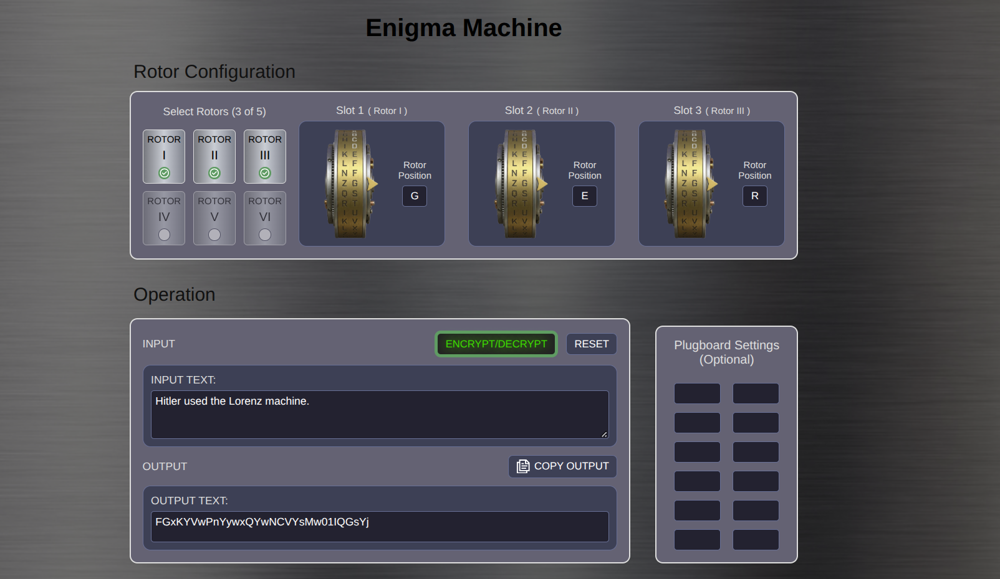

# ⚙️ Extended Enigma Machine

[](https://byhako.github.io/enigma_machine/)

An interactive, modern simulation of the historical World War II Enigma cipher machine, built with **Preact**, **TypeScript**, and **Vite**. 

While the original electromechanical Enigma machine was restricted strictly to the 26 uppercase Latin letters, this extended implementation dramatically expands the cryptographic alphabet to **86 characters**, supporting **uppercase, lowercase, numbers, spaces, punctuation, and mathematical/special symbols (`+-*=#$%&()@[]{}<>_!¡¿?`)**.

---

## 🌐 Live Demo

Experience and test the machine directly in your browser:  
👉 **[https://byhako.github.io/enigma_machine/](https://byhako.github.io/enigma_machine/)**

---

## 📸 Preview

[](https://byhako.github.io/enigma_machine/)

---

## 📜 Historical Context vs. Modern Enhancements

The **Enigma machine** was a series of electro-mechanical rotor cipher machines widely used by the German military during World War II to encrypt and decrypt sensitive military communications. 

Despite its historical complexity, the original military Enigma had significant limitations:
* **26-letter alphabet only:** No lowercase letters, numbers, spaces, punctuation, or symbols were supported.
* **Cumbersome workarounds:** Numbers had to be spelled out phonetically (*EINS*, *ZWEI*), words were merged together, and letters like `X` or `Z` were substituted for punctuation and spaces.

### ✨ What Makes This Version Different?

This project preserves the authentic mechanics of the Enigma cipher (rotors, stepping mechanism, reflector, and plugboard) while extending the symbol set to **86 characters**:

| Feature | Historical Enigma | This Extended Enigma |
| :--- | :--- | :--- |
| **Character Set** | 26 uppercase characters (`A-Z`) | **86 characters** (Full alphanumeric + extended symbols) |
| **Case Sensitivity** | ❌ Uppercase only | ✅ Preserves distinct uppercase and lowercase characters |
| **Spaces & Periods** | ❌ None (used substitutes like `X`) | ✅ Native support for space ` ` and period `.` |
| **Numbers** | ❌ Spelled out (e.g., *EINS*) | ✅ Native digits `0` to `9` |
| **Special Characters & Math** | ❌ Not supported | ✅ `+ - * = # $ % & ( ) @ [ ] { } < > _ ! ¡ ¿ ?` |
| **Plugboard Swaps** | Supported across 26 letters | Supported across all 86 characters |
| **Reflector Mechanics** | Reciprocal encryption | Reciprocal encryption preserved across all 86 characters |

---

## 🧩 How It Works

Just like the historical device, this machine is **reciprocal**: encrypting a ciphertext using the exact same rotor configuration, starting positions, and plugboard connections reproduces the original plaintext!

### Encryption Signal Path:

```
[ Input Character ]
        ↓
  [ Plugboard ]          (First character swap)
        ↓
 [ Rotor 1 (Fast) ]      (Forward substitution)
        ↓
[ Rotor 2 (Middle) ]     (Forward substitution)
        ↓
 [ Rotor 3 (Slow) ]      (Forward substitution)
        ↓
   [ Reflector ]         (Reflects signal backwards)
        ↓
 [ Rotor 3 (Slow) ]      (Backward substitution)
        ↓
[ Rotor 2 (Middle) ]     (Backward substitution)
        ↓
 [ Rotor 1 (Fast) ]      (Backward substitution)
        ↓
  [ Plugboard ]          (Second character swap)
        ↓
[ Ciphertext Character ]
```

After each keystroke, **Rotor 1 steps forward**. When a rotor reaches its turnover notch position, it triggers the adjacent rotor to step, creating complex polyalphabetic substitution that shifts with every single character.

---

## 🚀 Features

- **Extended 86-Character Alphabet:**
  ```text
  ABCDEFGHIJKLMNOPQRSTUVWXYZ .abcdefghijklmnopqrstuvwxyz0123456789+-*=#$%&()@[]{}<>_!¡¿?
  ```
- **Broad Symbol Support:** Encrypt full sentences, math expressions, code snippets, email handles, questions (`¿?`), exclamations (`¡!`), and grouped expressions (`()`, `[]`, `{}`).
- **Configurable Rotor Assembly:** Select any 3 rotors out of 6 custom 86-character rotor wirings.
- **Adjustable Rotor Initial Positions:** Choose starting positions for each rotor.
- **Mechanical Stepping Simulation:** Authentic odometer-style stepping and turnover notches.
- **Custom Plugboard (Steckerbrett):** Connect any pairs across all 86 characters to scramble the signal before and after the rotor stack.
- **Fast & Lightweight:** Built using **Preact** for instant rendering and minimal bundle size.
- **Clean & Responsive UI:** Vintage-inspired aesthetics with interactive rotor selectors, plugboard inputs, and encrypted output display.

---

## 🛠️ Tech Stack

- **Framework:** [Preact](https://preactjs.com/) (React-compatible lightweight UI library)
- **Language:** [TypeScript](https://www.typescriptlang.org/)
- **Bundler & Dev Server:** [Vite](https://vitejs.dev/)
- **Package Manager:** `pnpm` (compatible with `npm` and `yarn`)

---

## 💻 Getting Started

### Prerequisites

Ensure you have [Node.js](https://nodejs.org/) (version 18+ recommended) installed.

### Installation

1. **Clone the repository:**
   ```bash
   git clone https://github.com/Byhako/enigma_machine.git
   cd enigma
   ```

2. **Install dependencies:**
   ```bash
   pnpm install
   # or
   npm install
   ```

3. **Start the development server:**
   ```bash
   pnpm dev
   # or
   npm run dev
   ```

4. Open your browser and navigate to `http://localhost:5173`.

### Building for Production

To create an optimized production build:

```bash
pnpm build
# or
npm run build
```

To preview the production build locally:

```bash
pnpm preview
# or
npm run preview
```

---

## 📖 Usage Guide

1. **Select Rotors:**
   * Pick 3 rotors from the available rotor options (I through VI).
   * Set their initial positions (e.g., `A`, `b`, `5`, `@`, etc.).
2. **Configure the Plugboard (Optional):**
   * Connect pairs of characters (e.g., `A` ↔ `?`, `@` ↔ `9`, `+` ↔ `-`, ` ` ↔ `Z`).
   * Characters connected on the plugboard are swapped before entering and after exiting the rotor stack.
3. **Encrypt a Message:**
   * Type or paste your message into the input box (e.g., `¿Hello, World! (Total: $100.50) [ok]`).
   * Click **Encrypt** to generate the ciphertext.
4. **Decrypt a Message:**
   * Reset or re-align the rotors to the **exact same initial positions** and plugboard settings used during encryption.
   * Input the ciphertext and press **Encrypt** — the original plaintext is restored!

---

## 📄 License

This project is open source and available under the [MIT License](LICENSE).
